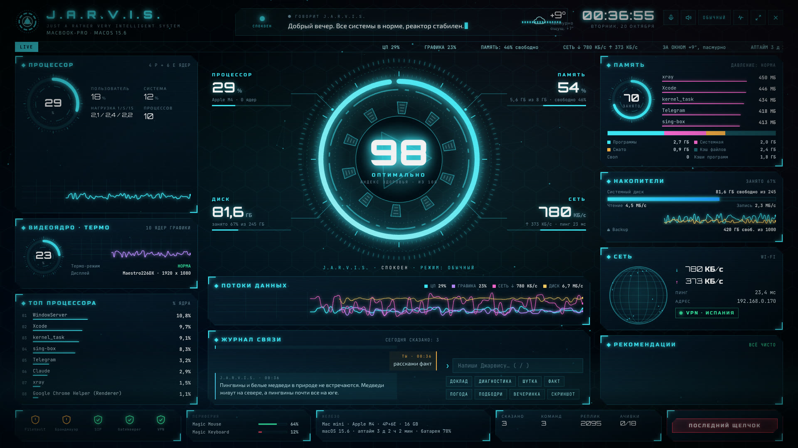
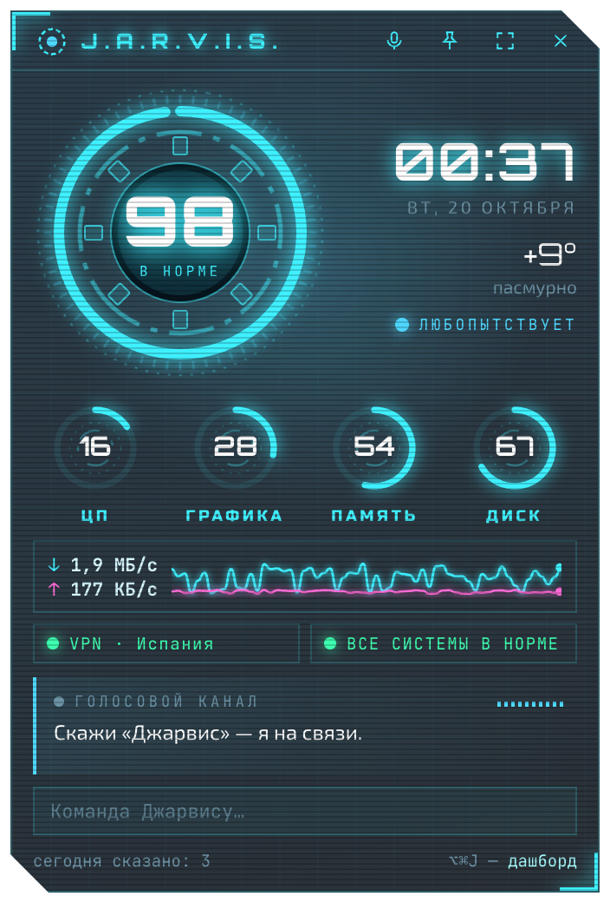
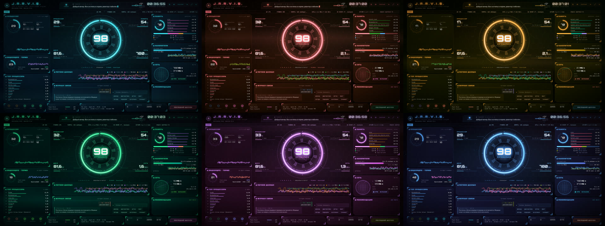

# J.A.R.V.I.S. for macOS

A voice assistant and system monitor for the Mac, styled after Iron Man's interface. It speaks and understands
**Russian** (other languages aren't supported yet). The neural voice runs entirely on your Mac, with no internet
connection. It comes with a full-screen dashboard, a desktop widget, and Mark-0, a tiny Iron Man who lives on top
of your windows.

> Unofficial fan project. Not affiliated with Marvel or The Walt Disney Company. J.A.R.V.I.S. and Iron Man
> belong to their respective owners.

[Русская версия](README.md)



<p align="center"></p>

<p align="center"><sub>Screenshots were taken in demo mode, so all data on them is fake.</sub></p>

## Features

**System monitor.** A health index for your Mac, CPU cores (P and E), GPU, thermals, memory, disks with read and
write speed, network with ping, VPN, security (FileVault, firewall, SIP, Gatekeeper), peripherals and their
batteries, and tips on what to clean up.



**Voice.** Wake word «Джарвис». The Silero neural voice runs locally and has 10 emotions that change the intonation
and the reactor's color. The voice lab lets you pick the voice, the effect ("Helmet", "Hologram", "Old radio"), pitch
and speed.

**Commands.** Open or quit any app, volume, music, screenshots, lock, sleep, weather, timers and pomodoros,
reminders, file search, protocols ("focus", "party", "ghost"), and your own commands in JSON.

**Plugins** (the `plugins/` folder, one skill per file):

| Plugin | What it does |
| --- | --- |
| `agenda` | Calendar events and an extended morning briefing |
| `context` | Active window, clipboard history, "what's on my screen" (needs an API key) |
| `projects` | Git status of your projects, "open project …" in Cursor, VS Code or Xcode |
| `guard` | New launch agents, apps that opened a network port, low disk space, macOS updates |
| `files` | Content search via Spotlight, sorting Downloads into folders with undo |
| `focus` | Stays quiet while you code for a long time or are on a call |
| `daily` | Daily and weekly summaries, evening report |
| `habits` | Water and any habits you want to track, with reminders |
| `notes` | Quick voice notes in `~/JARVIS/Заметки.md` |
| `music` | "What's playing", Apple Music playlists by name or mood |
| `windows` | Move a window left, right, full screen, center |
| `shortcuts` | Run macOS Shortcuts, which also covers HomeKit and smart home |
| `services` | Uptime monitoring for your own websites |
| `appearance` | Six color themes for the dashboard and widget |
| `doctor` | "Why are you quiet?", self-diagnostics |
| `say_api` | HTTP webhook and the `jarvis-say` script so other programs can speak in J.A.R.V.I.S.'s voice |
| `memory_cmds`, `plugin_admin` | Long-term memory, enabling and disabling plugins by voice |

**Six themes**: cyan, red, gold, green, violet and ice. Switch them by voice: «тема красная».



**LLM brain (optional).** When no built-in command matches, the request goes to Claude. It understands free-form
speech, remembers facts about you, and calls tools on its own: J.A.R.V.I.S. commands, calendar, projects,
clipboard, screen, and external MCP servers. Without an API key everything else works as usual.

## Requirements

- A Mac with Apple Silicon (M1 or newer). Tested on macOS 27, should work on macOS 13 and later.
- Python 3.11 or newer, preferably from [python.org](https://www.python.org/downloads/macos/).
- Command Line Tools for Xcode (`xcode-select --install`) to build the native app.
- About 1 GB of disk space for the voice model: torch and the Silero model are installed automatically on first run.
- A microphone for voice commands: built-in, AirPods, a headset or a webcam. Without one, type commands into the
  input field on the dashboard or the widget.

## Installation

```bash
git clone https://github.com/Komalangi/jarvis-mac.git ~/Desktop/JARVIS
python3 ~/Desktop/JARVIS/jarvis.py
```

The first run builds `~/Applications/JARVIS.app` and sets up the voice in a couple of minutes. After that, open
J.A.R.V.I.S. from Spotlight (Cmd+Space → JARVIS) or from the reactor icon in the menu bar.

Rebuild the app after changing the code:

```bash
python3 ~/Desktop/JARVIS/jarvis.py --rebuild
```

### macOS permissions

macOS asks for these the first time they're needed, and may ask again after a rebuild. That's expected.

| Permission | Used for |
| --- | --- |
| Microphone and Speech Recognition | Voice commands |
| Accessibility | Window control, pasting text, the VPN button |
| Automation (System Events, Calendar, Music) | Volume, lock screen, calendar, playlists |
| Screen Recording | Screenshots and "what's on my screen" |

### Connect the brain (optional)

You need an [Anthropic API key](https://console.anthropic.com/). It's stored in the macOS Keychain, not in a file:

```bash
security add-generic-password -U -s jarvis-anthropic -a jarvis -w
```

The command prompts for the key. Restart J.A.R.V.I.S. and say «Джарвис, настрой мозг». You can set the model and
your name in `~/Library/Application Support/JARVIS/brain.json`:

```json
{"enabled": true, "model": "claude-sonnet-5-5", "user_name": "Name"}
```

## Usage

Say «Джарвис», wait for the chime, then say the command. «Джарвис, что ты умеешь?» lists everything it can do.
The full list of commands and settings is in the [guide](docs/GUIDE.md) (in Russian).

| Keys | Action |
| --- | --- |
| Option+Command+J | Open the dashboard or collapse it into the widget |
| Esc | Collapse the dashboard into the widget |

## Configuration

All personal settings live outside the repository, in `~/JARVIS` and `~/Library/Application Support/JARVIS`:

| File | Contents |
| --- | --- |
| `~/JARVIS/Мои команды.json` | Your own voice commands: `app:`, `url:`, `folder:`, `file:`, `say:` |
| `~/JARVIS/Мои реплики.json`, `Мои реплики Марка.json` | Your own phrases on top of the built-in ones |
| `~/JARVIS/Произношение.json` | How to pronounce words and names |
| `~/JARVIS/Каналы.json` | Blog channels for ordering articles and covers from Claude |
| `~/JARVIS/Сервисы.json` | Websites to monitor |
| `~/JARVIS/mcp.json` | MCP servers for the brain |
| `Application Support/JARVIS/brain.json` | Model and your name for the brain |
| `Application Support/JARVIS/projects.json` | Folders with git projects and your editor |
| `Application Support/JARVIS/music.json` | Playlists for each mood |
| `Application Support/JARVIS/plugins_off.json` | Disabled plugins |

## Writing plugins

A plugin is a `plugins/name.py` file with a `register(api)` function:

```python
def register(api):
    api.command(r"привет,? марк", lambda raw, t, m: "Привет! Марк-0 на связи.")
    api.tool("dice", "Roll a die.", None, lambda: str(__import__("random").randint(1, 6)))
```

The API, background tasks, HTTP routes and MCP are described in [docs/PLUGINS.md](docs/PLUGINS.md) (in Russian).

## Privacy and security

- The server listens on `127.0.0.1` only. Every command that changes something requires the token from
  `~/Library/Application Support/JARVIS/token`.
- Voice, speech recognition and all plugins run locally. The only things that go online are weather, a ping to
  check the network, checks of the websites on your list, and, if you connected the brain, requests to the
  Anthropic API.
- Clipboard history is kept in memory only and isn't recorded while a password manager is in front.
- The brain can't shut down or restart the Mac or delete files. It only sees the MCP tools listed in `allow`.

## Development

```bash
python3 -m unittest discover -s tests          # tests
JARVIS_DEMO=1 python3 jarvis.py               # demo mode with fake data: http://127.0.0.1:7777
```

| File | Contents |
| --- | --- |
| `jarvis.py` | Core: sensors, commands, events, HTTP server, app build |
| `jarvis_sense.py` | Sensors for the full dashboard |
| `jarvis_voice.py` | Speech synthesis, emotions, audio effects |
| `jarvis_brain.py` | LLM brain, tools, memory |
| `jarvis_plugins.py` | Plugin loader |
| `jarvis_mcp.py` | MCP client |
| `JARVISApp.swift` | Native shell: windows, speech recognition, menu bar |
| `ui.html`, `widget.html`, `pet.html` | Dashboard, widget, Mark-0 |

## License

The code is released under the [MIT](LICENSE) license. The fonts in `fonts/` (Orbitron, Russo One, Exo 2,
JetBrains Mono) are under the [SIL Open Font License 1.1](fonts/OFL.txt).
